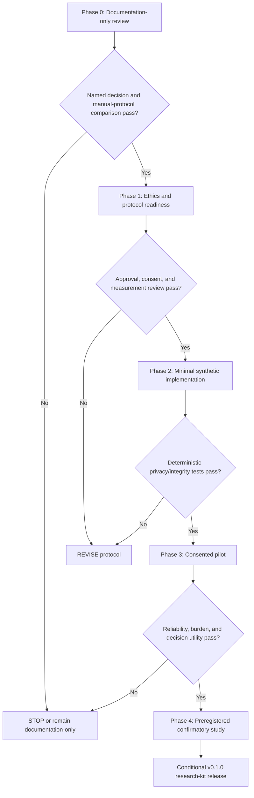

# DUAL-ASCENT Roadmap and Release Gates

## Recommendation-aligned sequencing

The recommendation is **REVISE**, not immediate software implementation. The first deliverable is a documentation-only review package. A software milestone is justified only if the manual/pilot protocol demonstrates that reproducible local records and receipts change a real decision better than a notebook or spreadsheet.

## Phases

| Phase | Deliverable | Exit gate | Stop/defer trigger |
|---|---|---|---|
| 0. Documentation-only review | This research package, evidence register, protocols, decision record, PR plan. | Reviewer confirms at least one decision, beneficiary, disconfirming outcome, and manual-protocol comparison. | No decision changes based on evidence; project remains a celebration of tools. |
| 1. Study readiness | Ethics/IRB determination, consent text, retention/withdrawal policy, preregistration draft, scoring rubric, model data-flow review. | Written authorization/determination, protocol owner, adverse-event contact, and approved data inventory. | Cannot meet consent/privacy requirements or intended study is not ethically defensible. |
| 2. Synthetic MVP | Contracts, receipts, static dashboard, fixtures, unit/integration tests; no live participant workflow. | All deterministic acceptance tests green and no external network assets. | Software introduces data collection/telemetry/diagnostic score or manual workflow is simpler. |
| 3. Pilot | Small approved feasibility study, not efficacy claim. | Predeclared rater agreement, acceptable burden/attrition, verified receipts, and a decision-utility review. | Low measurement reliability, harmful burden, privacy confusion, or no advantage over manual protocol. |
| 4. Confirmatory research | Preregistered EXP-001–004 in priority order, independent scoring and full reporting. | Results include raw distributions, CIs, negative outcomes, deviations, and reproducible analysis. | Evidence fails to support practical utility or reveals unacceptable trade-off. |
| 5. Conditional v0.1.0 release | Local protocol-integrity kit with synthetic examples and explicit limitations. | Security/privacy review, license review, all tests, study-readiness documentation, and decision record approval. | Any assertion of human benefit rests only on synthetic/code tests. |

## Prioritization

Do not run EXP-001–004 simultaneously; EXP-005 is an additional unranked candidate. Begin with EXP-002 because it has the clearest near-term decision, strongest directly relevant evidence, objective held-out outcomes, and an accessible manual pilot. EXP-001 follows only if a team actually faces a goal-versus-capability workflow choice. EXP-003 requires creative-work consent and robust rating design; EXP-004 is last because it is a benchmark of observable next-action prediction, not a test of agency.

| Priority | Experiment | Why | Required proof before next step |
|---:|---|---|---|
| 1 | EXP-002 | Tests the strongest, most actionable trade-off: task help versus independent transfer. | Feasible held-out assessment and ethical assistance constraints. |
| 2 | EXP-001 | Tests the motivating ordering claim without pathologizing exploration. | Valid manipulation and a real beneficiary/usefulness rubric. |
| 3 | EXP-003 | Addresses identity/diversity with explicitly plural outcomes. | Rater reliability and creative-work privacy safeguards. |
| 4 | EXP-004 | Technically auditable but risks anthropomorphic overclaim. | Precommitment/leakage audit and action-taxonomy agreement. |
| Candidate | **EXP-005** | Parallel AI-agent oversight and verified throughput; **not assessed in Monica rev3**. | Independent literature review, task-matching design, ethics and manual feasibility. |

> **Editorial note (2026-11-09):** EXP-005 below was proposed by QSOL-IMC after Monica's revision-three research package. Its hypotheses and methods are **not** part of Monica's independent evidence review. They remain provisional, and require their own literature, ethics, and measurement review before study registration.

## EXP-005 — The Orchestrator Paradox (provisional post-rev3 addition)

**Research question:** At what level of concurrent AI-agent work, if any, does additional parallelism cease improving *verified* human-directed outcomes, or begin impairing a human operator's ability to understand, review, and control the work?

This is a **proposed, falsifiable research question**, not an observed effect. A screenshot showing many browser tabs, anecdotal reports of high productivity, and active GitHub PR counts are not evidence of a generalizable overload threshold.

### Candidate hypotheses and alternatives

- **H1 (diminishing returns):** Verified task completions per unit of human review time increase initially but eventually plateau or decline as concurrent workstreams increase.
- **H2 (review trade-off):** At higher concurrency, independently adjudicated defect-detection sensitivity or retained task understanding decreases, even when raw output increases.
- **H3 (moderation):** Structured queues, written handoffs, explicit acceptance tests, and task grouping change the concurrency/outcome relationship.
- **Null/alternative:** No material overload occurs within tested conditions; skilled orchestration or task characteristics may explain apparent effects. The optimum may differ across people and domains.

A universal numeric threshold must **not** be announced from a single operator, pilot, or unpowered comparison.

### Feasibility protocol — design only

1. **Manual first:** Start with a prospective, opt-in manual work log and fixed review rubric. Do not introduce surveillance software.
2. **Operationalize concurrency:** Number of *simultaneously active independent AI workstreams*, not the number of browser tabs or models installed. Explore candidate conditions **1, 2, 4 and 8**, with ability to reduce levels for feasibility and safety.
3. **Control the workload:** Match task type, complexity, acceptance criteria, and review artifacts across conditions. Where possible, use pre-generated, version-pinned agent submissions so generation speed is not mistaken for human review capacity. Keep total available work and study time comparable.
4. **Counterbalance:** Randomize or counterbalance condition order and task assignments; evaluate learning, fatigue, order, model changes, and prior familiarity as confounders. A single-operator N-of-1 feasibility log cannot establish population effects.
5. **Blind adjudication:** Have separate reviewers determine ground-truth task quality and seeded/known defects without knowing the concurrency condition. Preserve false-positive as well as missed-defect counts.
6. **Independent understanding:** Use short unassisted explanations or delayed task-transfer assessments defined before the session. Distinguish successful delegation from inability to understand a critical decision.
7. **Stopping and burden:** Predeclare breaks and stopping conditions, respect voluntary withdrawal, and avoid collecting unrelated communications, private prompts, personal information, or device telemetry.

### Candidate outcome register

| Outcome | Operational measure | Evidence boundary |
|---|---|---|
| Verified throughput | Independently accepted tasks per scheduled human review hour | Not equal to raw agent output, PR count, or number of open tabs. |
| Review accuracy | Sensitivity and false-positive rate against known/adjudicated defects | Requires a controlled defect set; do not infer accuracy from CI green alone. |
| Oversight failures | Missed critical issues weighted or categorized by predeclared severity | Severity rules must be fixed before scoring. |
| Context switching | Opt-in manual count/time spent resuming task context; optional self-reported burden | Not a clinical attention or psychological diagnostic metric. |
| Retained understanding | Blinded rubric for unassisted explanation and/or delayed transfer | Separate immediate recall from independent skill retention. |
| Human agency | Documented ability to reject, defer, cancel, or redirect an agent's proposed work | Qualitative governance outcome; not a productivity rank. |

Do **not** combine these into a single 'human intelligence', 'AI dependency' or team-leader score. Report separate dimensions and uncertainty intervals; a productivity improvement cannot compensate for a preregistered critical safety/understanding failure.

### Research gates for EXP-005

- **G5-A — Construct validity:** Specify what counts as an agent/workstream, verified completion, critical defect, and independent understanding; review with independent researchers.
- **G5-B — Literature and alternatives:** Ask Monica to examine task-switching, cognitive load, automation bias, coordination overhead and human supervisory-control research, including evidence against any predicted saturation.
- **G5-C — Manual feasibility:** Test a simple paper/spreadsheet protocol with synthetic tasks first; establish whether workload matching, blinded scoring, and non-invasive measurement are possible.
- **G5-D — Preregistration and participant protection:** Obtain applicable review/consent and prespecify outcome contrasts, sample-size rationale, exclusion, missingness, order effects and stop rules before any live human study.
- **G5-E — Build decision:** Software is justified only if validated manual methods cannot reproducibly support the named decision with lower burden. Otherwise retain the protocol as documentation.

### Qualitative evidence intake — post-completion and quota limits

[EXP-005 Case Intake 001](EXP-005_CASE_INTAKE_001.md) documents **two contributor-supplied transcript excerpts**: continuing optional verification after a successful merge/deployment, and an apparent service-usage-limit interruption near a requested release-notes handoff. Source-file SHA-256 values and line references are recorded; the raw chats are deliberately **not published**. Both referenced GitHub PRs were independently confirmed merged.

**Evidence status: qualitative, unverified chronology; not a controlled study.** Neither case establishes a number of concurrent agents, a general overload threshold, provider usage totals or causation. Candidate additions to the future study are explicit completion criteria, optional-check authorization, residual-risk handoff, and graceful quota-limited artifact delivery. These **do not supersede** G5-A–G5-E or authorize a new application.

### Explicit non-goals

No automatic observation of employee activity, scraping browser tabs, covert time tracking, model-personality diagnoses, addiction/psychosis labels, performance surveillance, agent-count leaderboard, or unsupported 'ideal number of agents' recommendation.

### Pending Monica revision-three review

Request an independent EXP-005 literature and methods appendix that challenges these hypotheses; proposes a feasible, ethically reviewable controlled design; evaluates whether four concurrency levels are appropriate; and explicitly recommends **GO / REVISE / STOP** for this candidate independently of the larger DUAL-ASCENT implementation decision. Reconcile this draft with the authoritative rev3 research roadmap before any documentation PR or merge.

## Proposed release gates

**Gate G0 — Documentation integrity.** All empirical claims map to an evidence-register entry; inaccessible/unverified sources are marked; no GitHub PR opened by this commission.

**Gate G1 — Minimum decision utility.** A named human decision, beneficiary, and falsification condition are documented. A manual notebook/spreadsheet protocol is tested or reasoned through; software has a specific additional benefit such as reproducible receipt verification across studies.

**Gate G2 — Participant protection.** Ethics/IRB determination, consent, withdrawal, retention, recruitment, compensation, and external-model data handling are reviewed before any participant record exists.

**Gate G3 — Technical integrity.** Valid/invalid schema fixtures, tamper checks, no-network dashboard check, HTML escaping, export redaction, migration replay, and CI pass on supported Python versions.

**Gate G4 — Measurement feasibility.** Pilot demonstrates predeclared rater agreement, tolerable session time, acceptable delayed-test retention, valid randomization logs, and no unresolved privacy incident.

**Gate G5 — Evidence discipline.** Confirmatory results are preregistered and report null/mixed outcomes. Productivity cannot outweigh a failed human safeguard by relabeling it success.

## Explicit cancellation conditions

Cancel implementation, or retain only the research documentation, if any one condition persists after a revision attempt: no concrete decision is changed; manual protocol yields the same information at materially lower cost; research cannot be ethically approved; measures cannot attain usable reliability; live data collection requires invasive surveillance; or early results demonstrate that the dashboard/activity artifacts distract from the human decision they were built to serve.